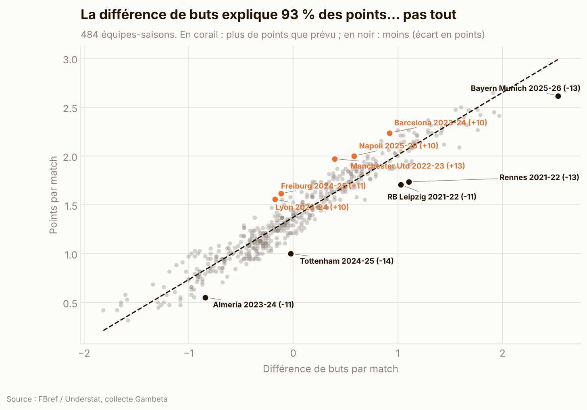
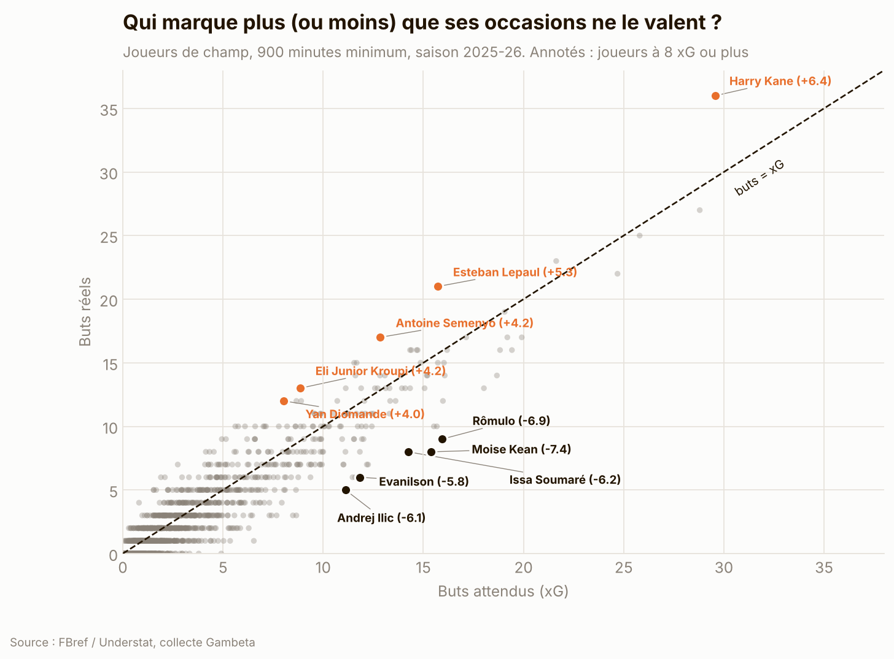

# gambeta. — le football, décodé par la donnée

Projet de data analyse sur les cinq grands championnats européens : collecte automatisée, base PostgreSQL,
requêtes SQL, API, analyses statistiques, modèles prédictifs évalués, étude de cas et site interactif.

**8 908 matchs · 5 saisons (2021-22 à 2025-26) · 5 championnats · 2 775 joueurs**

**Site en ligne : _lien Vercel à ajouter après le déploiement_**


---

## Sommaire

1. [Résultats clés](#1-résultats-clés)
2. [Contenu du projet](#2-contenu-du-projet)
3. [Architecture](#3-architecture)
4. [Données et qualité](#4-données-et-qualité)
5. [Lancer le projet](#5-lancer-le-projet)
6. [Mettre le site en ligne](#6-mettre-le-site-en-ligne)
7. [Structure du dépôt](#7-structure-du-dépôt)
8. [Limites et pistes](#8-limites-et-pistes)
9. [Auteur](#9-auteur)

---

## 1. Résultats clés

Analyses reproductibles dans [`analysis/gambeta_analyses.ipynb`](analysis/gambeta_analyses.ipynb) et
[`analysis/gambeta_modeles.ipynb`](analysis/gambeta_modeles.ipynb).

### La différence de buts explique 93 % des points, et l'écart restant ne se répète pas

Une régression des points par match sur la différence de buts par match (484 équipes-saisons) donne un R² de 0,93.
Les 33 équipes qui ont pris au moins 6 points de plus que prévu **en perdent en moyenne 6 la saison suivante**,
et les 23 qui en ont pris 6 de moins en regagnent 5.



### Les modèles prédictifs battent nettement une prédiction naïve

Évaluation sur 3 504 matchs de 2024-25 et 2025-26, chaque journée prédite avec les seuls matchs déjà joués :

| Modèle | Log loss | Précision |
|---|---|---|
| Poisson (Dixon-Coles) | 0,991 | 52 % |
| Elo | 1,008 | 52 % |
| Référence naïve | 1,076 | 43 % |

Les probabilités sont bien calibrées. Les points attendus (xPts) tirés du modèle s'écartent en moyenne de
7,5 points des points réels, et cet écart ne se répète pas d'une saison à l'autre (corrélation −0,03).

### L'avantage du terrain est réel, mais pas significatif sur chaque saison isolée

Sur 5 saisons cumulées, p ≈ 10⁻⁴². Pris séparément, 6 championnats-saisons sur 25 ne sont pas significatifs :
une saison de 380 matchs ne suffit pas toujours à distinguer l'effet du hasard.

### Finisseurs : Kane au-dessus de ses xG

Corrélation de 0,92 entre buts et xG en 2025-26. Harry Kane marque 6,4 buts de plus que ses xG, Moise Kean 7,4 de moins.



### Étude de cas : recruter un joueur offensif créateur à moindre coût

Profil traduit en cinq critères pondérés (création, implication, menace, percussion, repli), candidats classés
parmi les clubs de la moitié basse du classement, recommandation et limites. Les pondérations sont modifiables
sur le site pour tester la sensibilité du classement.

---

## 2. Contenu du projet

### Site interactif (React, D3.js)

Chaque page a un filtre global (saison ou période, championnat) appliqué à tous ses graphiques ; clubs et
joueurs apparaissent avec leur logo ou leur photo.

- **Championnats** et **Équipes** : classements, profils de jeu, évolution journée par journée, discipline.
- **Explorateur** : 22 indicateurs à croiser, corrélation recalculée à chaque filtre, recherche, export CSV.
- **Comparateur** : 2 ou 3 joueurs, synthèse, radar, 18 indicateurs en percentiles, position parmi tous les joueurs.
- **Analyses** : cinq questions de recherche avec tests statistiques.
- **Modèles** : Elo, Poisson Dixon-Coles, simulation Monte Carlo de fin de saison, évaluation, points attendus.
- **Étude de cas** : recrutement guidé par les données.
- **Méthodologie** : sources, traitement, contrôles, limites, glossaire.

### Requêtes SQL

Dix requêtes PostgreSQL commentées dans [`sql/`](sql/) (fonctions de fenêtre, gaps and islands, moyennes mobiles,
percentiles), avec leurs résultats dans [`sql/RESULTATS.md`](sql/RESULTATS.md).

### Tests et intégration continue

[`tests/`](tests/) : contrôles qualité des données et propriétés des modèles (pytest). GitHub Actions lance les
tests Python, le lint et le build du site à chaque push.

---

## 3. Architecture

```
  FBref ─┐                    ┌─► API FastAPI ──► Site React + D3.js (développement)
         ├─► Collecte Python ─┤        │
Understat┘   (soccerdata)     │        └─► export_static.py ──► JSON ──► Site publié (Vercel)
                 │            │
                 ▼            │   PostgreSQL (6 tables) ◄── requêtes sql/
           CSV par saison ────┘
                 │
                 └─► Notebooks (pandas, numpy, scikit-learn) ─► figures + JSON du site
```

| Étape | Outils | Rôle |
|---|---|---|
| Collecte | Python, soccerdata | FBref et Understat, reprise automatique en cas de blocage |
| Nettoyage | pandas | Rapprochement des noms entre sources, retrait des barrages, contrôles |
| Stockage | PostgreSQL, SQLAlchemy | Championnats, clubs, joueurs, stats par saison, classements, matchs |
| Requêtes | SQL | Analyses directement en base |
| API | FastAPI | Routes JSON, avec filtre par saison ou période |
| Analyse | Jupyter, numpy, scikit-learn | Régression, tests statistiques, clustering, Elo, Poisson, Monte Carlo |
| Restitution | React, D3.js, Tailwind | Site interactif, publié en statique |

---

## 4. Données et qualité

- **FBref** : résultats de tous les matchs, classements, minutes, tirs, tacles, interceptions, cartons (5 saisons).
- **Understat** : xG, xA, npxG, xGChain, xGBuildup par joueur (saison 2025-26).
- **API-Football** : logos des clubs et photos des joueurs.

Contrôles automatiques (notebook, tests et requête SQL 01) :

- chaque club a joué le bon nombre de matchs : **25 championnats-saisons sur 25** ;
- les buts des classements correspondent exactement aux buts des matchs : **écart 0** ;
- les **barrages** sont exclus des classements ;
- **rapprochement des joueurs** entre FBref et Understat : 92 à 97 % selon le championnat ;
- noms de clubs unifiés d'une saison à l'autre (« Paris SG » → « PSG »).

---

## 5. Lancer le projet

Prérequis : Python 3.11+, Node.js 20+, PostgreSQL.

```bash
# 1. API
cd backend
python -m venv venv && venv\Scripts\activate      # Windows (Linux/Mac : source venv/bin/activate)
pip install -r requirements.txt
copy .env.example .env                             # renseigner DATABASE_URL et API_FOOTBALL_KEY
python data_collection/load_to_db.py               # charge les CSV dans PostgreSQL
uvicorn main:app --reload                          # http://localhost:8000/docs

# 2. Site (autre terminal)
cd frontend
npm install
npm run dev                                        # http://localhost:5173

# 3. Tests et requêtes SQL
pip install -r tests/requirements.txt && pytest -q tests
python sql/run_all.py
```

### Recollecter les données

```bash
cd backend
python data_collection/collect_league.py all --seasons 2122 2223 2324 2425 2526
python data_collection/load_to_db.py
python ../analysis/export_insights.py
python ../analysis/export_models.py
```

La collecte ne télécharge que les fichiers absents : relancée, elle complète les xG Understat manquants.

---

## 6. Mettre le site en ligne

Le site publié ne dépend d'aucun serveur : les réponses de l'API sont exportées en fichiers JSON.

```bash
# API lancée (uvicorn main:app), depuis backend/ :
python export_static.py                            # écrit frontend/public/static-api/
```

Sur [vercel.com](https://vercel.com) : importer le dépôt GitHub, choisir `frontend` comme dossier racine. Le
fichier `frontend/vercel.json` règle le reste (build statique, routes). Chaque push sur `main` redéploie le site.

---

## 7. Structure du dépôt

```
gambeta/
├── analysis/                  Notebooks, chargement des données, modèles, exports JSON, figures
├── backend/
│   ├── data_collection/       Collecte, chargement en base, CSV par saison
│   ├── db/                    Modèles SQLAlchemy
│   ├── routes/                Routes de l'API (/api/data/...)
│   ├── export_static.py       Export du site statique
│   └── main.py                Application FastAPI
├── frontend/                  Site React (pages, graphiques D3, données statiques)
├── sql/                       Requêtes SQL commentées et résultats
├── tests/                     Tests pytest
├── docs/screenshots/
└── .github/workflows/ci.yml   Intégration continue
```

---

## 8. Limites et pistes

**Limites**
- xG et xA disponibles pour 2025-26 uniquement (Understat indisponible lors de la collecte des saisons précédentes).
- Pas de possession ni de passes progressives (non disponibles via soccerdata).
- Pas de données d'âge, de contrat ni de valeur marchande pour l'étude de cas.

**Pistes**
- Compléter les xG 2021-22 à 2024-25 et tester si la finition d'un joueur se répète d'une saison à l'autre.
- Points attendus à partir des tirs (xG par match) plutôt que des forces d'avant-match.
- Ajouter les compétitions européennes.

---

## 9. Auteur

**Cheikh Mouhamadou Habib FALL** · Licence professionnelle Télécommunications et Informatique (Développement
d'applications réparties), ESMT Dakar.

GitHub : [@habibfl](https://github.com/habibfl)

*Données utilisées à des fins d'étude, sans usage commercial.*
